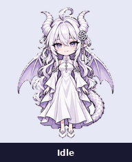

# dot 小龙娘

一套银发紫眸、有银角、淡紫龙翼和鳞尾的 Q 版人形龙娘素材。这个仓库是个人创作的素材包，不是 OpenAI 官方作品。

**角色视觉参考：** [Mccrree/chatgpt-dragon-character-assets](https://github.com/Mccrree/chatgpt-dragon-character-assets)。本包只包含重新绘制的 Q 版成品、精灵图和预览，不包含参考仓库的原图。

## 文件和使用方式

**在 ChatGPT 里打开你与 dot 的对话，复制发送：**

> 请用 https://github.com/Hiram711/dot-dragon-girl-assets 的 `pet/spritesheet-v2.png` 创建「dot 小龙娘」并设为你在这个对话里的 dot 头像，支持的话也启用为桌面宠物，以后按语境用 `static/` 里的图发聊天表情。

| 路径 | 用途 |
| --- | --- |
| `static/standard.png` | 常态立绘 |
| `static/bug.png` | 遇到问题的表情 |
| `static/found.png` | 发现线索的表情 |
| `static/done.png` | 完成任务的表情 |
| `pet/spritesheet-v2.png` | 透明 v2 精灵图，用于支持该格式的应用 |
| `preview/motion.gif`、`preview/motion.mp4` | 九种状态的循环 GIF 和约 10 秒的 MP4 |
| `preview/contact-sheet.png` | 带行号和状态名的精灵图索引 |
| `preview/look-directions.png`、`preview/look-loop.gif` | 16 个视线方向的静态索引和顺时针循环 |

四张立绘均为 1254 × 1254 像素的透明 PNG，可直接用于需要单张图的场景。想单独观看动作，可直接打开 GIF 或 MP4。

精灵图为 1536 × 2288 像素，采用 8 列 × 11 行网格，每格 192 × 208 像素。前九行从上到下分别是待机、向右跑、向左跑、挥手、跳跃、失落、等待、思考、检查。每行从左往右读取，未使用的格子保持透明。最后两行是 16 个顺时针视线方向，首格为向上，随后每格递增 22.5°。这些格子不包含中性视线；中性视线使用待机帧。

在仓库根目录下运行 `sha256sum -c SHA256SUMS` 可检查文件完整性。

## 署名和许可说明

本仓库新增且由 Hiram711 有权授权的贡献（包括 Q 版素材的新增绘制、编排及文档），按 [MIT 许可证](LICENSE) 发布。MIT 许可不覆盖 Mccrree 的原角色设计、原图或其他第三方权利。参考原图未随本仓库分发。此署名不表示原作者或 OpenAI 对本包的背书。
